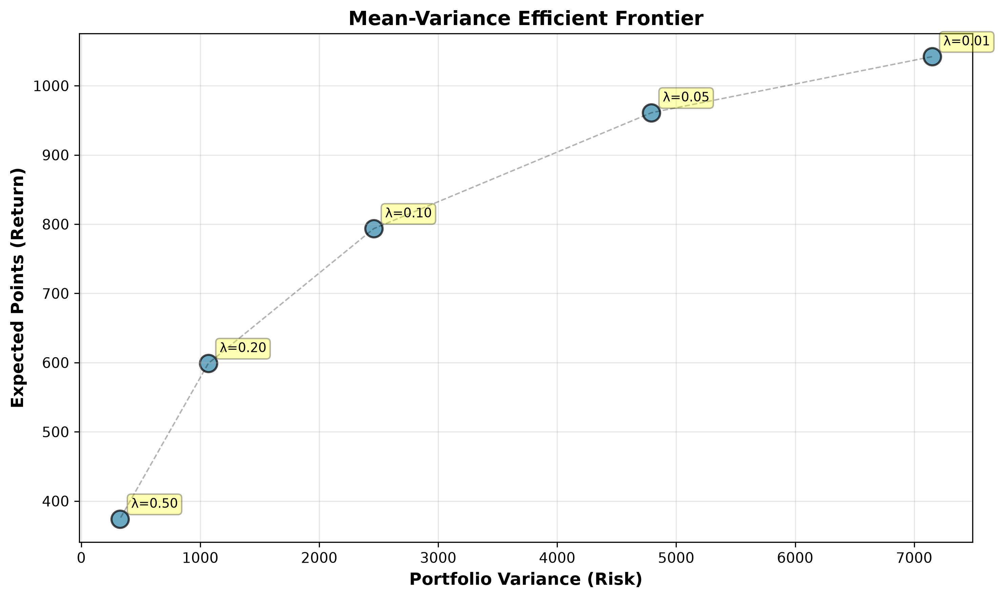

# FPL Squad Optimisation via Modern Portfolio Theory

After exploring portfolio optimisation in my first year, I recognised parallels between FPL squad selection and portfolio construction. In both cases, there are budget constraints, returns and diversification that all influence the optimal allocation. This motivated me to apply Modern Portfolio Theory to Fantasy Premier League, using mathematical optimisation to construct a squad under real-world game constraints.

## Question
Can portfolio optimisation techniques improve FPL team selection compared to a simple greedy-picking heuristic?

## Data
- 2025–26 season player and gameweek data from the [vaastav/Fantasy-Premier-League](https://github.com/vaastav/Fantasy-Premier-League) repository
- 841 players, filtered to an active pool of 400 by adding a minutes threshold (at least 450 minutes played across the season)
- 29,757 player-gameweek rows across 38 gameweeks

## Method

- First, I established a simple greedy baseline by ranking players on points per game per £1m and selecting within squad constraints, before estimating each player's expected gameweek points μ and variance σ² from historical gameweek data. The aim was to implement two portfolio-style methods (mean-variance and balanced optimisation) and seeing how well these performed against the greedy selection. 
- **Mean-variance optimisation**: I formulated an integer program using PuLP, maximising expected points whilst introducing a risk penalty (λ = 0.01). This allowed me to select an optimal 15-player squad and starting XI under budget, position, squad-size and 3-players-per-club constraints.
- **Balanced optimisation**: For the balanced version, I normalised expected points and risk, then swept the weight α across several values from 0 to 1 to trace an efficient frontier. From here, I selected the solution with the highest Sharpe-style ratio (points / √risk). 

## Results

| Strategy | Expected points | Risk | Sharpe-style ratio |
|---|---|---|---|
| Greedy | 42.9 | 156.2 | 3.43 |
| Mean-variance (λ = 0.01) | 56.1 | 170.8 | 4.29 |
| Balanced (α = 0.5) | 43.7 | 84.3 | 4.76 |



## Key finding

The results were that mean-variance optimisation maximised expected points, but took on greater risk. This highlighted the trade-off between maximising returns and building a more balanced squad. With the balanced optimiser, this squad improved the Sharpe-style ratio by 39% over the greedy baseline, while reducing risk by 46% and delivering slightly higher expected points. 

## Limitations

I had this project in mind purely to explore the parallels between FPL and portfolio optimisation without severe complexity affecting the project. As a result, many limitations occurred: 

- The risk involved only uses individual variances. A 400x400 covariance matrix was estimated but I eventually chose to leave it out to keep the problem linear for PuLP.
- The risk-penalty parameter λ was chosen by hand rather than calibrated.
- Parameters are estimated and evaluated on the same season, so there's no out-of-sample test.
- The Sharpe-style ratio has no risk-free rate, so it isn't a true Sharpe ratio.
- I also left out FPL chips used throughout the season like Wild Card, Bench Boost, Free Hit, and Triple Captain for simplicity. 

## How to run

```
pip install -r requirements.txt
```

Then open `fpl_optimization.ipynb` and run all cells.